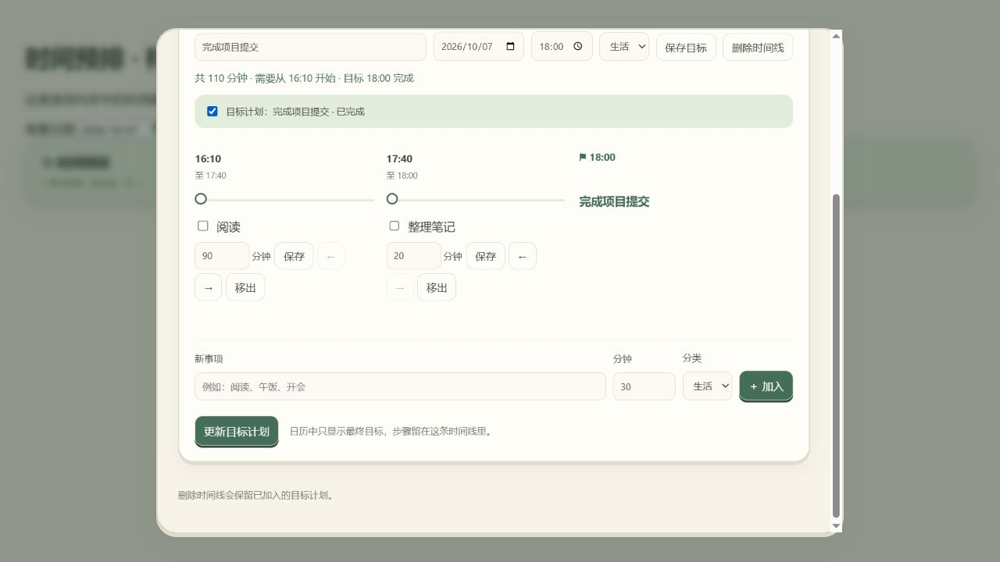
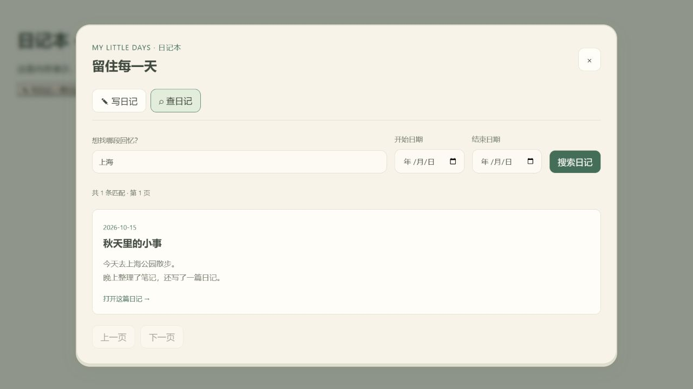
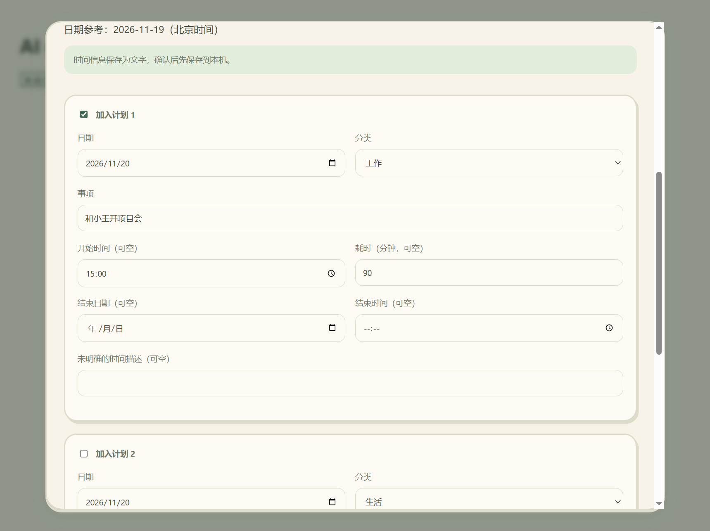
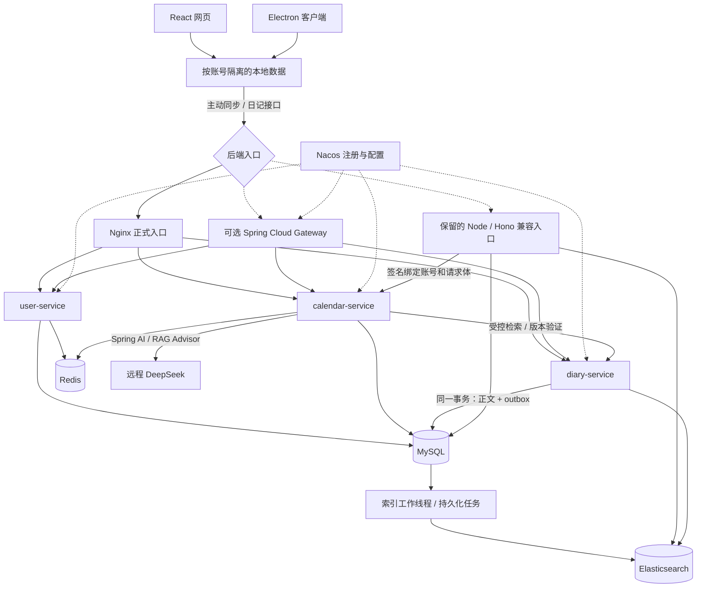

# My Life · 日历与日记助手

[](https://github.com/cdew359/my-life-calendar/actions/workflows/ci.yml)

把计划排进日历，把经历写进日记，再从历史记录中找回线索。一个包含 **Spring Cloud Java 后端、React 网页和 Electron Windows 客户端**的个人全栈项目。

从日常记录需求出发，逐步实现多端同步、目标倒推时间线、日记全文搜索，以及基于 Spring AI 的计划草稿与日记问答。项目规模较小，重点是业务规则、数据一致性和持续迭代。

[功能与截图](#功能与截图) · [系统架构](#系统架构) · [本地运行](#本地运行) · [验证](#验证) · [设计文档](#设计文档)

产品官网：[imlaomi.cn](https://imlaomi.cn/) · 网页入口：[cal.imlaomi.cn](https://cal.imlaomi.cn/)

> 线上为个人使用环境，需要账号，不提供公开测试口令。AI 一期已完成真实 DeepSeek、服务端与 Windows 0.6.0 客户端整链路联调。自行部署时 AI 默认关闭，需在后端配置密钥；源码可能领先于已发布版本。

## 功能与截图

| 功能 | 业务行为 |
| --- | --- |
| 日历与计划 | 月历、农历、节气、放假调休；工作/生活分类、完成状态、习惯打卡 |
| 目标倒推时间线 | 先设置最终目标与完成时间，再按步骤耗时向前倒推；支持跨天，只将最终目标发布为计划 |
| 日记与搜索 | 按日编辑；关键词与日期范围检索；版本校验避免直接覆盖另一设备的改动 |
| 生日与提醒 | 公历、农历、闰月生日；前晚及当天提醒；客户端运行时使用通知 |
| 多端与分享 | 网页/Electron 本地保存、主动同步；账号隔离、删除墓碑、指定账号分享 |
| AI 计划草稿 | 自然语言生成可编辑草稿；确认后保存，不直接执行模型输出 |
| 日记 RAG | ES 召回片段，MySQL 回查版本，生成带来源编号的答案，可打开日记原文 |

以下截图使用虚构样例；AI 图来自模拟响应，不代表真实模型或线上服务已经启用。

<details open>
<summary>目标倒推时间线</summary>



</details>

<details>
<summary>日记关键词搜索</summary>



</details>

<details>
<summary>AI 草稿预览：编辑后再保存</summary>



</details>

## 技术栈

| 层次 | 选型 |
| --- | --- |
| Java 后端 | Java 17、Spring Boot 4.0.9、Spring Cloud 2025.1.4、Spring Cloud Alibaba 2025.1.0.0 |
| 服务治理 | Nacos 注册与配置、OpenFeign、LoadBalancer；Nginx 入口，Gateway 可选 |
| 数据访问 | MyBatis Starter 4.0.1、MySQL 8.4、Redis 7.4 |
| 检索与 AI | Elasticsearch 8.x、Spring AI 2.0.2、远程 DeepSeek |
| 网页与桌面 | React 19、TypeScript、Vite 6、Electron |
| 兼容后端 | Node.js、Hono；保留原有部署入口，与 Java 共享业务协议 |
| 交付与验证 | Maven 多模块、npm、Docker Compose、JUnit、Node Test Runner、GitHub Actions 配置 |

## 系统架构



Java 服务采用 `controller → service → dao`；请求与响应用业务 DTO，数据库行使用 entity，工具放在 util，SQL 放在 MyBatis XML。Gateway 不引入空置的 Service/DAO 层。

2026-11-24 正式环境切换为 Nginx 直接转发三个 Java 业务服务，停止常驻 Node 与 Java Gateway；Nacos 继续提供注册配置和内部 Feign 寻址。迁移时统一登录签名密钥，并可通过旧密钥校验兼容尚未过期的 Cloud 会话。部署示例和边界见 [Nginx Cloud 部署](docs/nginx-cloud-deployment.md)。

Node 入口与 Java 服务是兼容演进关系，共享模式使用同一个 MySQL 与 ES 索引。保留 Node 桥接模式时，不同登录密钥之间通过专用短期内部签名调用 AI，不放宽原登录校验。项目没有消息队列、分布式事务框架或多实例容量验证。

## 核心设计与取舍

**多端同步与兼容。** 日历保留每账号 JSON 快照，更新时在数据库事务锁内合并；条目冲突按更新时间处理，删除保留墓碑，习惯打卡取并集。旧客户端缺少新字段时有兼容保护。这便于渐进迁移，但当前全量快照与共享锁不适合直接扩展为高并发同步系统。

**日记与搜索最终一致。** 正文和 outbox 同事务提交；索引失败不回滚已经保存的日记。工作线程使用独立事务和 `FOR UPDATE SKIP LOCKED` 认领任务，失败退避重试。ES 用于召回，MySQL 是正文和版本的权威来源。

**有界线程池。** 手动创建两个工作线程的 `ThreadPoolExecutor`，交给 Spring 管理生命周期；有界队列、Semaphore 批次上限、拒绝处理和停机等待控制任务积压。持久化待办在数据库，不依赖内存队列保证可靠性。

**AI 与业务写入分离。** 模型只生成结构化建议。程序校验字段、日期、整数分钟和引用编号，再由用户编辑确认。批量保存使用稳定 ID 和整批校验；模型不能直接分享、删除、创建提醒或执行工具。

**全文 RAG。** 第一期复用 ES 关键词检索，不新增向量数据库。每次只发送本人少量片段；旧索引、删除记录和版本不一致的材料被过滤，回答返回与缓存重放前再次验证引用。检索结果不能冒充全量统计。

**调用治理。** AI 默认关闭；Redis 限制并发、每日次数及十分钟结果缓存，MySQL 保存不含正文的审计与幂等状态。失败和结果未知时不自动重试付费调用。限额为保守请求计数，并非提供商账单。

## 本地运行

建议 Node.js 24 LTS、JDK 17、Maven 3.9。在项目根目录安装依赖：

```sh
npm ci
npm --prefix server ci
```

### 路线 A：快速体验网页和本地计划

把根目录 `.env.example` 复制为 `.env.local`，保持 `VITE_SYNC_SERVER=http://localhost:8788`，然后：

```sh
npm run dev:full
```

打开 `http://localhost:5180`。开发模式的本地注册码为 `dev-register`，只用于本地测试。未配置数据库时使用文件模式，计划、时间线与同步可体验；云端日记、ES 搜索和 AI 不在此最小模式中启用。

开发模式未显式配置 `SECRET` 时，每次重启生成新签名密钥，需要重新登录。需要固定本地配置时，在启动 API 的终端设置变量；Node 不自动加载 `server/.env`。

### 路线 B：阅读与构建 Java 后端

在 IntelliJ IDEA 打开 `cloud/pom.xml`，或运行：

```sh
mvn -f cloud/pom.xml clean verify
```

测试使用 H2、模拟服务及关闭的 Nacos，不需要生产账号、DeepSeek 密钥或正在运行的 ES。启动完整业务则需要 MySQL、Redis、Nacos、ES 与私有环境配置，见 [Java 后端](cloud/README.md) 和 [本地部署说明](docs/development.md)。

### Electron 客户端

```sh
npm run dev:desktop
npm run pack:win
```

本机模式可直接使用日历；连接本地测试 API 时同时启动 `server/`。Windows 安装包输出到被 Git 忽略的 `release/`。关闭主窗口进入托盘，完全退出使用托盘菜单；开机自启仅打包版支持。

## 验证

```sh
npm test
npm run build
npm --prefix server run typecheck
npm --prefix server test
npm run format:check
npm run comments:check
npm run public:check
mvn -f cloud/pom.xml clean verify
```

当前本地验证：前端 111 项、Node 21 项、Java 45 项测试通过；Node 另有 2 项需真实数据库/ES 的集成测试在无配置时跳过。Java 同步兼容测试使用 59 组 TypeScript 生成的对照用例。常规测试使用模拟 HTTP，不默认消耗真实额度。

2026-11-20 使用独立假数据账号完成上线验证：正式入口与 Cloud 能力检测、真实计划提取、跨入口幂等重放、MySQL/ES 日记检索、带引用问答，以及客户端草稿确认、IPC 保存、同步与原文跳转。此验证不等于长期稳定性或并发容量测试。

提供 GitHub Actions 工作流，推送后执行构建、测试与公开内容检查；实际状态以仓库 Actions 为准。Electron 图形冒烟、真实外部服务和生产容量检查不包含在该工作流内。

## 项目结构

```text
cloud/
  common/           跨服务 DTO、令牌、鉴权与异常
  gateway/          路由与入口
  user-service/     账号与登录限流
  calendar-service/ 日历合并、计划草稿、RAG 编排与 AI 治理
  diary-service/    日记、版本校验、outbox 与 ES 访问
src/                网页与客户端共用的 React / TypeScript
electron/           主进程、IPC、本地原子落盘与通知
server/             Node 兼容入口、共享数据访问和 AI 身份桥接
tests/              纯函数测试与隔离 UI 样例
docs/               设计说明与虚构样例截图
.github/workflows/  持续集成
```

## 设计文档

- [Java 三层结构与 MyBatis](docs/java-project-structure.md)
- [业务 DTO 与 JSON 转换边界](docs/java-business-dtos.md)
- [日记索引线程池、事务与补偿](docs/diary-index-thread-pool.md)
- [AI 与日记问答实现](docs/ai-rag-implementation.md)
- [Spring AI 升级及事件录入设计](docs/ai-event-entry-design.md)
- [RAG 演进设计](docs/rag-business-design.md)
- [本地运行与部署配置](docs/development.md)
- [公开仓库维护](docs/public-repository.md)
- [代码规范](docs/code-style.md)

## 已知边界与后续方向

面向个人小规模使用，不宣称高并发或生产高可用。提醒依赖打开的网页或运行中的客户端；计划保存本机后按同步入口提交，不在每次编辑后自动上传。AI 需要用户主动触发和后端配置，2GB 服务器的内存余量较小，保留压力保护与程序回退机制。向量与混合检索、完整统计查询和容量优化留待后续评估。

仓库不附带生产密钥、账号数据、私人日记、安装包或数据库备份。当前未附 LICENSE，许可证待确定。
